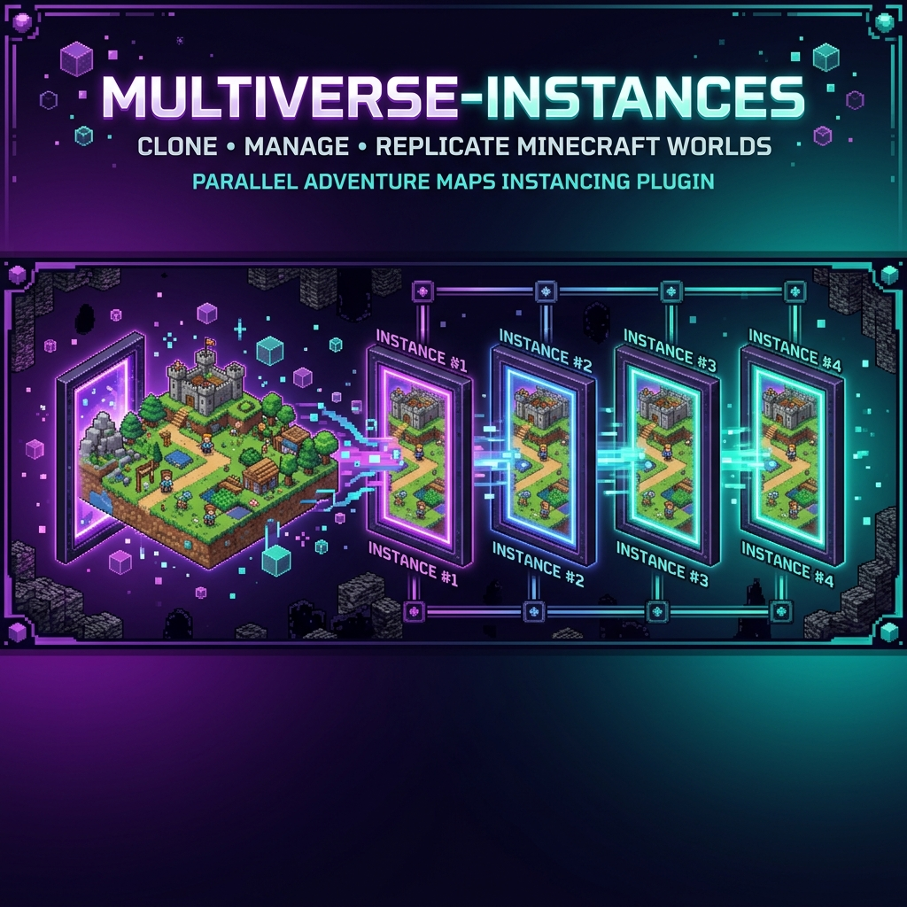

<p align="center">
  
</p>

<h1 align="center">Multiverse-Instances</h1>

<p align="center">
  <strong>Plugin de Minecraft para crear instancias paralelas de mapas adventure</strong>
</p>

<p align="center">
  <a href="#características">Características</a> •
  <a href="#instalación">Instalación</a> •
  <a href="#comandos">Comandos</a> •
  <a href="#configuración">Configuración</a> •
  <a href="#compilación">Compilación</a>
</p>

<p align="center">
  
  
  
  
</p>

---

## ¿Qué es?

**Multiverse-Instances** es un addon de [Multiverse-Core](https://github.com/Multiverse/Multiverse-Core) que permite crear **instancias paralelas** de mapas adventure (CTM, dungeons, mapas con checkpoints) para que múltiples equipos puedan jugarlos **concurrentemente** en el mismo servidor.

> Un equipo juega en `inst_ctm_vortex_equiporojo`, otro en `inst_ctm_vortex_equipoazul` — **mismo mapa, misma dificultad, cero interferencia**.

### El problema

Mapas como **CTM (Complete The Map)** o dungeons adventure tienen un único mundo. Un equipo lo juega, los demás esperan. O se montan múltiples servidores/contenedores Docker.

### La solución

Multiverse-Instances clona worlds de Multiverse en instancias aisladas, cada una con su propio:

- 🎮 Estado de jugadores (inventario, ubicación, progreso)
- 🏆 Progreso de win conditions (monumentos CTM, checkpoints, boss HP)
- ⚙️ Configuración de condiciones de victoria
- ⏱️ TTL / auto-reset

---

## Características

### 🗺️ Instanciación de mundos
- Clonación automática de worlds usando la API de Multiverse-Core 5
- Prefijo configurable para mundos instanciados (`inst_` por defecto)
- Límite de instancias activas configurable
- TTL (Time To Live) con auto-cleanup

### 🏆 Win Conditions

| Tipo | Descripción |
|------|-------------|
| **CTM** | Evalúa destrucción de bloques de monumento (NETHERITE_BLOCK, BEACON, etc.) |
| **Dungeon** | Evalúa muerte de boss con fases opcionales y BossBar sincronizada |
| **Checkpoint** | Evalúa regiones de WorldGuard como puntos de control con partículas |

### 👥 Sistema de equipos
- Creación de equipos con invitaciones
- Inventarios aislados por instancia
- Gestión de abandono con auto-save de ubicación

### 📋 Plantillas (Templates)
- Define tipo de win condition por mapa base
- Registra checkpoints y monumentos directamente in-game
- Integración con **WorldEdit** (selección de posiciones) y **WorldGuard** (regiones de checkpoint)

---

## Instalación

### Requisitos

- **Servidor**: Paper/Spigot 1.20.4 — 1.21.x
- **Java**: 21+
- **Dependencia**: [Multiverse-Core 5.6.1](https://github.com/Multiverse/Multiverse-Core)
- **Opcional**: [WorldEdit](https://enginehub.org/worldedit), [WorldGuard](https://enginehub.org/worldguard) (para checkpoints y regiones)

### Pasos

1. Instala Multiverse-Core 5.6.1 en tu servidor
2. Descarga o compila `Multiverse-Instances-1.0.0.jar`
3. Copia el JAR a la carpeta `plugins/`
4. Reinicia el servidor
5. Configura `plugins/Multiverse-Instances/config.yml`

---

## Comandos

### Gestión de instancias

| Comando | Descripción | Permiso |
|---------|-------------|---------|
| `/mi create <mapa> [equipo]` | Crear instancia de un mapa base | `mi.admin.create` / `mi.player.create` |
| `/mi list` | Listar instancias activas | `mi.admin.list` |
| `/mi info <instancia>` | Ver detalles de una instancia | `mi.admin.list` |
| `/mi delete <instancia>` | Eliminar instancia | `mi.admin.delete` |
| `/mi force-reset <instancia>` | Resetear instancia al estado original | `mi.admin.delete` |
| `/mi purge` | Eliminar instancias huérfanas | `mi.admin.delete` |
| `/mi reload` | Recargar configuración | `mi.admin.reload` |

### Jugadores

| Comando | Descripción | Permiso |
|---------|-------------|---------|
| `/mi join <instancia>` | Unirse a una instancia | `mi.player.join` |
| `/mi leave` | Salir de la instancia actual | `mi.player.join` |
| `/mi status` | Ver progreso de win condition | `mi.player.join` |

### Equipos

| Comando | Descripción | Permiso |
|---------|-------------|---------|
| `/mi team create <nombre>` | Crear equipo | `mi.player.team` |
| `/mi team invite <jugador>` | Invitar a equipo | `mi.player.team` |
| `/mi team accept` | Aceptar invitación | `mi.player.team` |
| `/mi team leave` | Dejar equipo | `mi.player.team` |
| `/mi team info` | Ver estado del equipo | `mi.player.team` |

### Plantillas

| Comando | Descripción | Permiso |
|---------|-------------|---------|
| `/mi template set <ctm\|checkpoint\|dungeon> [world]` | Definir plantilla base | `mi.admin.template` |
| `/mi template info [world]` | Ver plantilla actual | `mi.admin.template` |
| `/mi template list` | Listar plantillas | `mi.admin.template` |
| `/mi template checkpoint add <id> [region]` | Registrar checkpoint | `mi.admin.template` |
| `/mi template checkpoint remove <id>` | Eliminar checkpoint | `mi.admin.template` |
| `/mi template monument add <id> <material>` | Registrar monumento CTM | `mi.admin.template` |
| `/mi template monument remove <id>` | Eliminar monumento | `mi.admin.template` |

### Aliases

```
/mi = /mvi = /multiverseinstances = /minstances
```

---

## Permisos

| Permiso | Descripción | Default |
|---------|-------------|---------|
| `mi.admin.*` | Todos los permisos de admin | op |
| `mi.admin.create` | Crear instancias | op |
| `mi.admin.delete` | Eliminar instancias | op |
| `mi.admin.list` | Listar todas las instancias | op |
| `mi.admin.others` | Ver/gestionar instancias de otros | op |
| `mi.admin.reload` | Recargar configuración | op |
| `mi.admin.template` | Gestionar plantillas | op |
| `mi.player.*` | Todos los permisos de jugador | true |
| `mi.player.join` | Unirse a instancia | true |
| `mi.player.create` | Crear instancia propia | true |
| `mi.player.team` | Usar sistema de equipos | true |
| `mi.bypass.limit` | Ignorar límite de instancias | op |

---

## Configuración

### config.yml

```yaml
# --- Ajustes globales ---
instance:
  prefix: "inst_"                    # prefijo para mundos instancia
  max-instances: 10                  # máximo de instancias activas
  default-ttl: 3600                  # TTL en segundos (0 = sin límite)
  auto-cleanup-on-victory: true      # limpiar instancia al completar
  reset-on-cleanup: true             # resetear mundo al limpiar
  clone-mode: "mirror"               # mirror = copia exacta

# --- Win Condition: CTM ---
ctm:
  enabled: true
  require-all: true                  # todos los monumentos para victoria
  victory-trigger: "broadcast"       # broadcast | reward | command
  victory-commands:
    - "bc §6¡Equipo %team% ha completado el mapa!"
    - "give %player% diamond 1"
  broadcast-title:
    title: "§6§l¡VICTORIA!"
    subtitle: "§eMapa completado"

# --- Win Condition: Dungeon ---
dungeon:
  enabled: true
  boss-bar:
    entity-type: "WITHER_SKELETON"
    health-bar-sync: true
  victory-on-death: true

# --- Win Condition: Checkpoint ---
checkpoint:
  enabled: true
  max-checkpoints: 10
  save-on-advance: true
  particles:
    enabled: true
    type: "END_ROD"
    view-distance: 32.0

# --- Inventarios aislados ---
inventory:
  isolate: true
  save-mode: "instance"              # instance | team
  enderchest-isolate: true
```

---

## Arquitectura

```
com.nyanhalla.multiverseinstances/
├── MultiverseInstances.java              # Plugin principal
├── commands/
│   ├── InstanceCommand.java              # /mi create, list, info, delete, template...
│   ├── JoinCommand.java                  # /mi join, leave
│   ├── StatusCommand.java                # /mi status
│   └── TeamCommand.java                  # /mi team subcommands
├── core/
│   ├── Instance.java                     # Entidad: world + metadata + players + winstate
│   ├── InstanceManager.java              # Lifecycle de instancias (create/delete/expire)
│   ├── WorldCloner.java                  # Wrapper sobre Multiverse WorldManager
│   └── WinConditionEngine.java           # Motor de evaluación de win conditions
├── winconditions/
│   ├── WinCondition.java                 # Interfaz abstracta
│   ├── CTMWinCondition.java              # Evalúa monumentos
│   ├── DungeonWinCondition.java          # Evalúa muerte de boss + fases
│   ├── CheckpointWinCondition.java       # Evalúa registro de checkpoints
│   └── CustomWinCondition.java           # Scriptable via config (futuro)
├── listeners/
│   ├── BlockBreakListener.java           # Detecta destrucción de monumentos CTM
│   ├── BlockPlaceListener.java           # Protección de bloques de monumento
│   ├── EntityDeathListener.java          # Detecta muerte de boss en dungeon
│   ├── PlayerMoveListener.java           # Detecta entrada en regiones checkpoint
│   ├── PlayerQuitListener.java           # Gestiona abandono de instancia
│   └── WorldListener.java               # Detecta unload de mundo instancia
├── integrations/
│   ├── WorldEditHook.java               # Integración con WorldEdit
│   └── WorldGuardHook.java              # Integración con WorldGuard
├── storage/
│   ├── InstanceDataStore.java           # Interface de almacenamiento
│   ├── YAMLInstanceStore.java           # Almacenamiento YAML
│   └── YAMLTemplateStore.java           # Almacenamiento de plantillas
├── templates/
│   ├── MapTemplate.java                 # Plantilla de mapa base
│   └── TemplateManager.java             # Gestión de plantillas
├── models/
│   ├── Team.java                        # Equipo con miembros y tag
│   ├── Checkpoint.java                  # checkpoint {id, region, location}
│   └── Monument.java                    # monumento {material, location, broken}
├── tasks/
│   └── CheckpointParticleTask.java      # Partículas en checkpoints activos
└── utils/
    ├── InstanceUtils.java               # Helpers de instancia
    └── MessageUtils.java               # Formateo de mensajes con color
```

### Flujo: crear una instancia

```
1. /mi create ctm_vortex EquipoRojo
         │
2. InstanceManager.createInstance(baseWorld, teamName)
         │
3. Verifica: límite, mundo base, plantilla existente
         │
4. WorldCloner.cloneWorld("ctm_vortex", "inst_ctm_vortex_equiporojo")
         │
5. TemplateManager.applyTemplate(instance) + createInstanceRegions()
         │
6. WinCondition.initializeInstance(instance)
         │
7. Broadcast: "Instancia creada para EquipoRojo"
```

### Flujo: victoria CTM

```
1. Jugador destruye NETHERITE_BLOCK
         │
2. BlockBreakListener detecta el evento en mundo de instancia
         │
3. CTMWinCondition.onBlockBreak(instance, block)
         │
4. markMonumentCompleted(instance, monument)
         │
5. if (allMonumentsCompleted) → triggerVictory()
         │                            │
         │                     broadcast / rewards / commands
         │                     if auto-cleanup → deleteInstance()
```

---

## Compilación

### Requisitos de compilación

- **Maven** 3.8+
- **Java** 21+
- **Multiverse-Core 5.6.1** instalado en el repositorio local de Maven

> **Nota**: El JAR de Multiverse-Core 5.6.1 no está publicado en repositorios Maven estándar.
> Descárgalo desde [GitHub Releases](https://github.com/Multiverse/Multiverse-Core/releases/tag/5.6.1) e instálalo manualmente:
>
> ```bash
> curl -L -o /tmp/multiverse-core-5.6.1.jar \
>   "https://github.com/Multiverse/Multiverse-Core/releases/download/5.6.1/multiverse-core-5.6.1.jar"
>
> mvn install:install-file \
>   -Dfile=/tmp/multiverse-core-5.6.1.jar \
>   -DgroupId=com.onarandombox.multiversecore \
>   -DartifactId=multiverse-core \
>   -Dversion=5.6.1 \
>   -Dpackaging=jar \
>   -DgeneratePom=true
> ```

### Compilar

```bash
mvn clean package
```

El JAR resultante estará en `target/multiverse-instances-1.0.0.jar`.

---

## Dependencias

| Dependencia | Versión | Tipo | Uso |
|-------------|---------|------|-----|
| [Paper API](https://papermc.io/) | 1.20.4+ | **provided** | API del servidor |
| [Multiverse-Core](https://github.com/Multiverse/Multiverse-Core) | 5.6.1 | **softdepend** | Clonación y gestión de mundos |
| [WorldEdit](https://enginehub.org/worldedit) | 7.2.6+ | **softdepend** | Selección de posiciones para monumentos y checkpoints |
| [WorldGuard](https://enginehub.org/worldguard) | 7.0.9+ | **softdepend** | Regiones de checkpoint |

---

## Roadmap

- [ ] Soporte SQL (SQLite/MySQL) para persistencia
- [ ] Integración con GriefDefender para checkpoints
- [ ] GUI de gestión de instancias (menú interactivo)
- [ ] Webhook de victoria (Discord)
- [ ] Migración de inventarios entre instancias
- [ ] Win condition scriptable vía config

---

## Licencia

Este proyecto está desarrollado por [Nyanhalla](https://github.com/Nyanhalla).

---

<p align="center">
  <sub>Hecho con ❤️ para la comunidad de Minecraft</sub>
</p>
